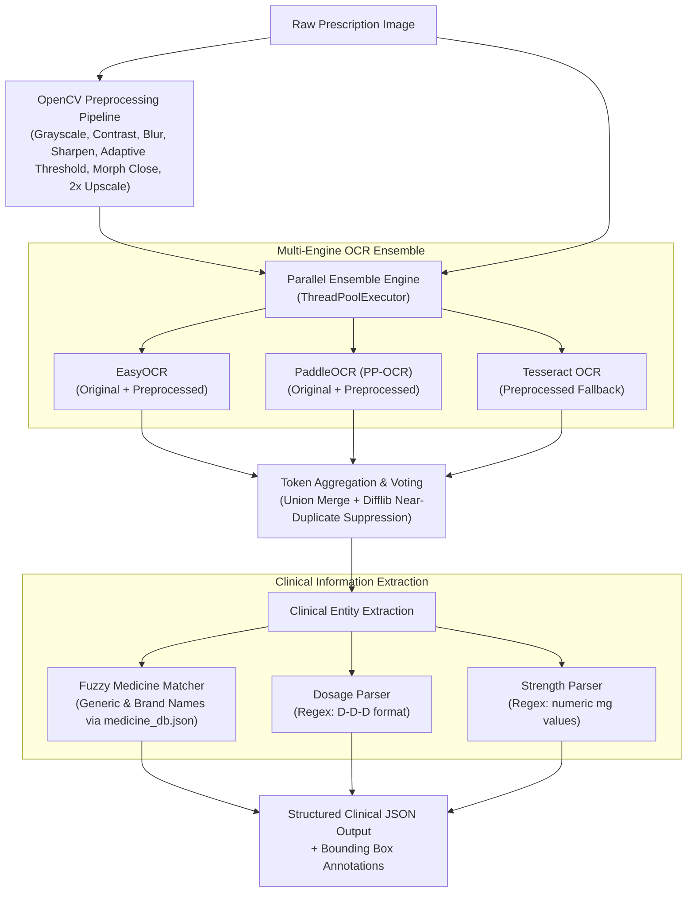
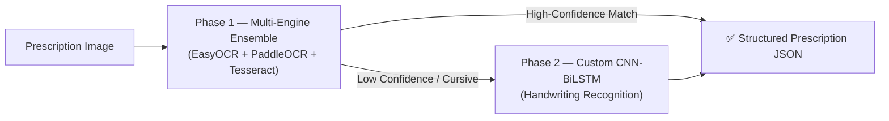

# Medical Prescription OCR — Multi-Engine Ensemble (Phase 1 Baseline)

This repository contains an automated optical character recognition (OCR) system designed to digitize medical prescriptions using an **ensemble architecture** combining **EasyOCR**, **PaddleOCR**, and **Tesseract OCR**.

This project establishes a high-recall baseline fallback architecture, utilizing computer vision filters, parallel multi-engine OCR extraction, and fuzzy clinical entity matching. It serves as the foundational data-extraction layer for an ongoing fourth-year main project (custom CNN-BiLSTM for complex cursive handwriting).

---

## 🧠 System Architecture



### 1. Image Preprocessing (OpenCV)
- **Contrast Boost:** Scaled contrast with `convertScaleAbs(alpha=1.6)` to separate faint handwriting from paper backgrounds.
- **Noise Reduction & Sharpening:** Gaussian blur followed by convolution with a sharpening Laplacian kernel.
- **Adaptive Gaussian Thresholding:** Dynamic binarization to compensate for uneven lighting or shadows.
- **Morphological Closing:** `MORPH_CLOSE` with a $2 \times 2$ kernel to connect broken pen strokes.
- **Bicubic Upscaling:** $2\times$ cubic interpolation to increase character pixel density for OCR engines.

### 2. Multi-Engine OCR Ensemble
- **EasyOCR (PyTorch):** Deep learning CRAFT text detector with CRNN recognizer. Evaluates both original and preprocessed images.
- **PaddleOCR (PaddlePaddle):** Ultra-lightweight and accurate directional text detection & recognition (`PP-OCR` models). Evaluates both original and preprocessed images.
- **Tesseract OCR (pytesseract):** Traditional LSTM-based OCR engine operating in uniform text block mode (`--psm 6`). Optional engine that gracefully handles missing binaries without interrupting the pipeline.

### 3. Token Merging & Voting Logic
- Executes all engines simultaneously using Python's `ThreadPoolExecutor`.
- Merges token streams using a **union-merge with near-duplicate suppression**:
  - Tokens are normalized (lowercased, non-alphanumeric stripped).
  - Near-duplicate variations (e.g., `"Cetirizine"` vs. `"Cetirizne"`) are collapsed using sequence matching (`difflib` similarity cutoff $\ge 0.85$).
  - Preserves token order to maximize recall for dosage and strength regex matching.

### 4. Clinical Entity Structuring
- **Medicine Detection:** Fuzzy string matching against generic names and common Indian brand names in `medicine_db.json`.
- **Dosage Frequency:** Regex pattern matching standard prescription schedules (e.g., `1-0-1`, `1-1-1`, `0-0-1`).
- **Strength Extraction:** Captures milligram quantities (e.g., `500mg`, `200mg`).
- **Database Enrichment:** Maps detected drugs to indications (uses) and potential side effects.

---

## 📁 Project Structure

```
medical_prescription_project/
│
├── app.py                  # CLI pipeline: preprocessing → Ensemble OCR → entity extraction → console output
├── streamlit_app.py        # Web UI: file upload, live ensemble progress, expander view, JSON output
├── easyocr_test.py         # Minimal smoke-test script
│
├── medicine_db.json        # Local medicine knowledge base (uses, side effects & brand names)
│
├── test.jpeg               # Sample prescription image (test input)
├── test (1).jpeg           # Alternate sample prescription image
├── test.png                # PNG sample prescription image
└── processed_output.png    # Preprocessed artifact from the latest execution
```

---

## 🛠️ Technology Stack

| Layer | Tools & Libraries |
|---|---|
| **Image Processing** | OpenCV (`cv2`), NumPy, Pillow |
| **OCR Engines** | EasyOCR, PaddleOCR (PaddlePaddle), PyTesseract |
| **Concurrency** | `concurrent.futures.ThreadPoolExecutor` |
| **Entity Matching** | Regular Expressions (`re`), `difflib` |
| **Web Interface** | Streamlit |
| **Runtime** | Python 3.10 / 3.11 |

---

## 🚀 Usage

### 1. Interactive Web Application (Streamlit)

Start the local web server:

```bash
cd medical_prescription_project
streamlit run streamlit_app.py
```

Then navigate to **`http://localhost:8501`** in your browser.

**Features:**
- **File Upload:** Drag-and-drop `.jpg`, `.jpeg`, or `.png` prescription scans.
- **Progress Indicator:** Live loading spinner while the parallel ensemble processes the image.
- **Per-Engine Inspection:** Collapsible expander (`🔬 View per-engine raw outputs`) showing independent token contributions from EasyOCR, PaddleOCR, and Tesseract.
- **Visual Highlighting:** Green bounding box drawn on the prescription around detected medicine names.
- **Aggregated Text View:** Full consolidated text before entity extraction.
- **Structured JSON Card:** Formatted clinical card with medicine name, dosage schedule, strength, indications, and side effects.

---

### 2. CLI Mode (`app.py`)

Run the ensemble directly in your terminal:

```bash
cd medical_prescription_project
python app.py
```

**Sample Terminal Output:**
```text
Running ensemble OCR (EasyOCR + PaddleOCR + Tesseract)...

Merged Extracted Text:
Cefv f- Ooorf &he _ Cet Ooms 'Zhe Cetrigine 200mg 1-1-1

------ INTERPRETED PRESCRIPTION ------
Medicine: Cetirizine
Strength: 200mg
Dosage:   1-1-1

Uses:
Allergy relief

Side Effects:
Drowsiness

Processed image saved as: processed_output.png
```

---

## 💊 Medicine Database (`medicine_db.json`)

The local knowledge base covers **15 common therapeutic medicines**, mapping generic drugs to indications, side effects, and brand aliases:

| Generic Name | Common Indian Brand Aliases | Clinical Indication |
|---|---|---|
| **Paracetamol** | Dolo, Crocin, Calpol, Metacin, Pacimol | Pain relief and fever reduction |
| **Cetirizine** | Cetzine, Okacet, Alerid | Allergy relief |
| **Amoxicillin** | Amoxil, Mox, Novamox | Bacterial infections |
| **Azithromycin** | Azithral, Zithromax, Azee | Bacterial infections |
| **Pantoprazole** | Pantocid, Pan, Pantodac | Acidity, GERD |
| **Metformin** | Glycomet, Cetapin | Type 2 diabetes |
| **Atorvastatin** | Atorva, Lipitor | Cholesterol control |
| *(+ 8 more)* | Combiflam, Augmentin, Voveran, etc. | — |

---

## ⚙️ Installation & Setup

### 1. Clone & Set Up Virtual Environment

```bash
git clone <repo-url>
cd medical_prescription_project/medical_prescription_project

# Create a Python 3.10 or 3.11 virtual environment
python -m venv venv
# On Windows:
.\venv\Scripts\activate
# On Linux/macOS:
source venv/bin/activate
```

### 2. Install Python Dependencies

```bash
pip install easyocr paddlepaddle paddleocr pytesseract streamlit opencv-python numpy
```

> [!NOTE]
> - **Pretrained Model Downloads:** On the first execution, EasyOCR and PaddleOCR will automatically download their model weights (~100 MB each) into user cache directories.
> - **Tesseract OCR (Optional):** If you wish to enable Tesseract alongside EasyOCR and PaddleOCR on Windows, install the [UB-Mannheim Tesseract OCR installer](https://github.com/UB-Mannheim/tesseract/wiki). The system automatically detects installations in `C:\Program Files\Tesseract-OCR` and gracefully skips Tesseract if the binary is not present.

---

## 📈 Role in the Larger Pipeline

While the multi-engine ensemble significantly boosts recall on standard printed and semi-legible handwriting, complex cursive doctors' notes remain challenging.

This repository serves as the **verified baseline and fallback layer**:
- Clear, printed prescriptions are resolved directly by this Phase 1 ensemble.
- Complex cursive prescriptions are routed to the **Phase 2 CNN-BiLSTM** handwritten text recognition model, using this system for validation and fallback.



---

## 📄 License

This project is developed for academic and educational purposes.
